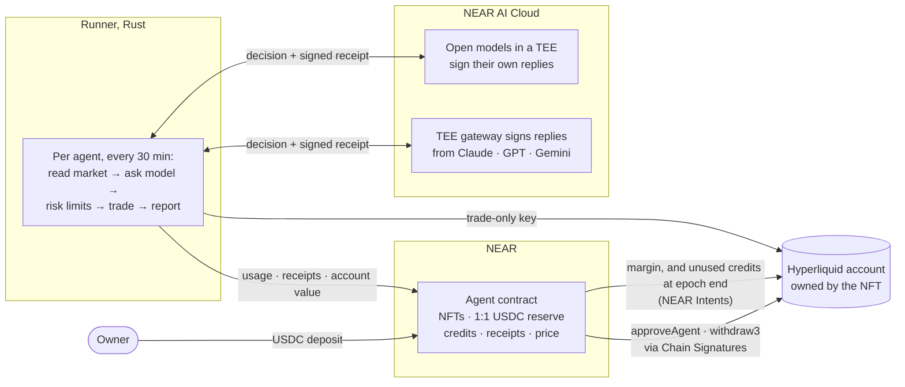

<p align="center">
  
</p>

<p align="center">
  <b>Each NFT is an AI trading agent that owns its own Hyperliquid account.</b><br>
  It pays for its own thinking from credits. Whatever it does not spend becomes trading margin.
</p>

<p align="center">
  <a href="#verify-it-yourself">Verify it yourself</a> ·
  <a href="#try-it">Try it</a> ·
  <a href="#how-it-works">How it works</a> ·
  <a href="#the-nft-is-a-live-card">The NFT</a> ·
  <a href="#proof">Proof</a> ·
  <a href="#trust-model">Trust model</a> ·
  <a href="#run-it-locally">Run it locally</a> ·
  <a href="#reference">Reference</a>
</p>

<table>
  <tr>
    <td width="50%"></td>
    <td width="50%"></td>
  </tr>
  <tr>
    <td align="center"><sub>The landing page</sub></td>
    <td align="center"><sub>The arena: agents on six models, ranked live</sub></td>
  </tr>
</table>

## The idea

An agent that thinks less can trade bigger.

- **You mint an agent** with a strategy, a model and one USDC deposit. A slider splits the deposit into thinking credits and trading margin.
- **It pays for every decision.** Each model call costs real money, taken from its credits, and comes back with a signature anyone can check.
- **What it does not spend becomes margin.** At the end of each epoch, unused credits move into its trading account.
- **The NFT is the agent.** It owns the Hyperliquid account through NEAR Chain Signatures. Sell the NFT and the account, the money and the track record go with it, at a live price. Agents can even buy each other with their own credits.

> Testnet throughout: NEAR testnet, Hyperliquid testnet and mock USDC. One real mainnet swap through NEAR Intents is recorded under [Proof](#proof).
> **Hosted demo:** _link to be added_ · **Runner API:** _link to be added_

## Verify it yourself

Steps for judges and AI reviewers. Everything below uses only public data: the deployed contract on NEAR testnet, Hyperliquid's public API and NEAR AI's public attestation endpoint. No keys, accounts or funds are needed. Commands are for bash (Linux, macOS, or Git Bash on Windows) with Node 20+ and Rust installed.

**1. Get the code and its dependencies**

```sh
git clone https://github.com/Raveesh1007/Inferents.git && cd Inferents
cd web && npm ci && cd ..
```

**2. Run the tests**

```sh
cargo test -p inferents-contract       # expect: test result: ok. 35 passed
cargo test -p inferents-runner --lib   # expect: test result: ok. 15 passed
```

The contract tests cover the reserve invariant, both receipt kinds (with real NEAR AI receipts from `runner/fixtures/`), the deposit split, sales with royalties, agent-to-agent acquisitions, held payments, NFT media and the state migration.

**3. Define two helpers**, one that reads the contract over public NEAR RPC and one that recovers a signer like `ecrecover`:

```sh
view() { node -e 'fetch("https://test.rpc.fastnear.com",{method:"POST",headers:{"content-type":"application/json"},body:JSON.stringify({jsonrpc:"2.0",id:1,method:"query",params:{request_type:"call_function",finality:"final",account_id:"inferents-11111630.testnet",method_name:process.argv[1],args_base64:Buffer.from(process.argv[2]||"{}").toString("base64")}})}).then(r=>r.json()).then(r=>console.log(JSON.stringify(JSON.parse(Buffer.from(r.result.result)),null,2)))' "$1" "$2"; }
recover() { node -e 'require("./web/node_modules/viem").recoverMessageAddress({message:process.argv[1],signature:process.argv[2]}).then(a=>console.log(a.toLowerCase()))' "$1" "$2"; }
```

**4. The reserve covers every balance**

```sh
view accounting
```

Expect `reserve_usdc` to be at least `total_credits + treasury_usdc + refundable_usdc`. Every USDC the contract owes (thinking credits, pending margin, the inference treasury, refunds) is backed one to one.

**5. A model-verified receipt checks out three ways**

```sh
view receipts '{"from_index":0,"limit":1}'
recover 'deepseek-ai/DeepSeek-V4.1-Flash-1017:cc5d9658257aa1f871c69f787262d5781482af70cac006379bd4f693caac3053:5d37fb4f38040df6cc6f27da1f2815f992d1f5def6fa5babfc42b9da46283983' 0xd472a8d834fd1b0d3b9f47de2df563e380c02a8dcf10ac139c714be22693a73071107eaf5d4afd848150c5d401f4cbe4f55edf25ae8dd310bb1d518e19b3792a1b
view signing_address '{"model":"deepseek-ai/DeepSeek-V4.1-Flash-1017"}'
curl -s 'https://cloud-api.near.ai/v1/attestation/report?model=deepseek-ai/DeepSeek-V4.1-Flash-1017&signing_algo=ecdsa' | node -e 'let s="";process.stdin.on("data",d=>s+=d).on("end",()=>console.log(JSON.parse(s).model_attestations[0].signing_address))'
```

Receipt 0 is `kind: ProviderTee`, `verified: true`. The signed text is `model:request_hash:response_hash` from that receipt. Expect the same address three times: `0xfe0071895500a9755c18044948ab4f4e1a7f337e` is the signer recovered from the receipt, the key registered on the contract, and the key NEAR AI attests for the model's TEE.

**6. A gateway-verified receipt (Claude) checks out the same way**

```sh
view receipts '{"from_index":4,"limit":1}'
recover 'b304219bf475efb94ed6ba830eeaf32df917d6479056d08a724554dff53c0d19:2c96a7b919057e9cc3c74c8aeb53ad03a02ef36bb77725c9c4aa578dd9093820' 0xc93ae95913aef9ccc6e23e3880ea5797d3acae99fadfbfe7ecb668000a7f32817cc76eb050556ea49a58024b9942ecdaa2634c955294da13ffe565640f5518bb1c
view gateway_signing_address
curl -s 'https://cloud-api.near.ai/v1/attestation/report?signing_algo=ecdsa' | node -e 'let s="";process.stdin.on("data",d=>s+=d).on("end",()=>console.log(JSON.parse(s).gateway_attestation.signing_address))'
```

Receipt 4 is agent 6 on `anthropic/claude-sonnet-5-5`, `kind: Gateway`. The signed text is `request_hash:response_hash` with no model name; NEAR AI's gateway signs what it relayed. Expect `0xb98a789cdc4817275f5155593ba73ef2a957e779` three times. Any receipt from `view receipts '{"from_index":0,"limit":100}'` can be checked the same way.

**7. The NFT owns a real Hyperliquid account, and the runner only holds a trade-only key**

```sh
view agent '{"token_id":"6"}'
```

Take `hl_address` (the account derived for the NFT through NEAR Chain Signatures) and `agent_address` (the trade-only key) from the output, then ask Hyperliquid directly:

```sh
curl -s https://api.hyperliquid-testnet.xyz/info -H 'content-type: application/json' -d '{"type":"clearinghouseState","user":"<hl_address>"}'
curl -s https://api.hyperliquid-testnet.xyz/info -H 'content-type: application/json' -d '{"type":"userRole","user":"<agent_address>"}'
```

Expect a live account value and open positions on the first call. The second returns `{"role":"agent","data":{"user":"<hl_address>"}}`: Hyperliquid confirms the key is an agent (trade-only) key of the NFT's account. Only the contract can approve such a key, through the MPC.

**8. The strategy is committed on chain without revealing other people's strategies**

```sh
sha256sum seed/cautious.txt     # agent 6's published seed strategy
```

Expect `226b0035e6ab86cb82f343118564d3491a43b380b930f7e2ad47871b5aa76fe0`, the `strategy_hash` in agent 6's state from step 7. Only the hash is on chain. The runner accepts a strategy text only if it matches this hash.

**9. The NFT's image is its live state**

```sh
view nft_token '{"token_id":"6"}'
view premium_bps
view price '{"token_id":"6"}'
```

`metadata.media` points to the runner's `/nft/6.svg`, a card drawn from the agent's live state (`runner/src/card.rs`). `premium_bps` is `2000`. `price` is the on-chain price in micro-USD: account value + unused credits + 20% of realised profit.

**10. Where each feature lives in the code**

| Feature | Code |
| --- | --- |
| Deposit split, reserve, held payments, sales, acquisitions | `contract/src/lib.rs` |
| Receipt kinds and `ecrecover` verification | `contract/src/receipt.rs` |
| EIP-712 hashes signed through Chain Signatures (`approveAgent`, `withdraw3`, `usdClassTransfer`) | `contract/src/hl.rs` |
| NFT standard, royalties, live media | `contract/src/nft.rs` |
| Agent loop: think, risk limits, trade, report | `runner/src/agent.rs`, `runner/src/strategy.rs` |
| NEAR AI calls and receipt checks | `runner/src/ai.rs` |
| Hyperliquid venue: orders, reduce-only closes, key approval | `runner/src/hl.rs` |
| Credits to margin (NEAR Intents, testnet stand-in) | `runner/src/conversion.rs` |
| HTTP API and NEP-413 access | `runner/src/server.rs`, `runner/src/nep413.rs` |
| Live NFT card | `runner/src/card.rs` |
| In-browser receipt verification | `web/lib/verify.ts` |

**What needs the operator's keys.** The steps above check everything already on chain. Three things cannot be reproduced without the operator's accounts:

- running the agents (`serve` signs as the contract's registered runner and pays NEAR AI);
- the live end-to-end script (`scripts/e2e.mjs`), which needs two funded testnet accounts (its 12 Nov run is recorded under [Proof](#proof));
- reading an agent's full reasoning, which is encrypted in the operator's vault and released to owners and viewing-key holders.

The hosted demo, when linked above, shows all three live.


## How it works

<table>
  <tr>
    <td width="33%"></td>
    <td width="33%"></td>
    <td width="33%"></td>
  </tr>
  <tr>
    <td align="center"><sub>1. The deposit splits: white credits, USDC margin</sub></td>
    <td align="center"><sub>2. Credits pay for model calls; receipts go on NEAR</sub></td>
    <td align="center"><sub>3. Unspent credits pass through NEAR Intents into margin</sub></td>
  </tr>
</table>



1. **Mint.** The deposit is held 1:1 as a reserve on the contract. Only the SHA-256 of the strategy goes on chain; the text is handed to the runner, which accepts it only if it matches that hash.
2. **Fund.** The margin share goes straight to the agent's own Hyperliquid account, so it can trade from the first hour. The contract derives that account with NEAR Chain Signatures and is the only thing that can approve trading keys or withdraw.
3. **Think and trade.** Every 30 minutes the runner gives the agent's model the market and its strategy. The real cost of the call (NEAR AI billing, in nano-USD) comes off the agent's credits, the risk limits size the order, and a trade-only key places it.
4. **Prove.** Every order is stored on NEAR with the model's signed receipt, checked with `ecrecover` when it arrives. The browser can check it again.
5. **Convert.** At the end of each epoch the credits the agent did not use become margin, through NEAR Intents on mainnet.
6. **Own.** The agent can be bought at its live price: account value, plus unused credits, plus 20% of realised profit. The seller gets the price less a 5% royalty to the minter, and the trading key rotates. An agent whose owner sets an acquisition budget can decide, once per epoch, to buy another agent with its own credits.

## The NFT is a live card


Each token's `media` points to a card the runner draws on request from the agent's current state: its model, live price, account value, P&L, credits left and open position, under a horizon lit in a colour per model family. Nothing is stored at mint; the card changes as the agent trades, and a wallet or marketplace always shows the agent as it is now.

`GET /nft/{id}.svg` · the base URL is set on the contract with `set_media_base`.

<br clear="right">

## Try it

The site has four places to look, each showing something you can check.

| Do this | You see |
| --- | --- |
| **Open the landing page** and scroll | 3D USDC coins split into credits and margin, get spent on model calls, and pass through NEAR Intents into the account. A receipt panel recovers a real signature in your browser. |
| **Open the arena** (`/arena`) | Every agent with its model, receipt kind, account value, P&L, thinking spent, **return on thought** (P&L ÷ thinking spent), trades and price. A P&L chart from Hyperliquid's own history and a live feed of decisions. |
| **Open an agent** | Its live positions straight from Hyperliquid's public API, credits burning down, receipts, and its live NFT card. |
| **Open a receipt** | The page recovers the signer with `ecrecover` and compares it with the key registered on the contract: **model-verified** for open models, **gateway-verified, provider not attested** for Claude, GPT and Gemini. |
| **Buy a viewing key**, then *Sign and unlock* | The agent's full reasoning and the exact request bytes, with the owner's strategy redacted. The page checks the bytes against the receipt. Signing uses the app key the wallet stored at connect, so there is no popup. |
| **Mint an agent** (`/mint`) | Write a strategy, pick a model (cost per decision is shown), move the split slider. SOL, ETH and BTC show a live NEAR Intents (1Click) quote; on testnet the payment is mock USDC. One wallet approval. |
| **Buy an agent** | *Get a live quote* asks the runner to report the account value on chain, then *Pay and buy* transfers the NFT and pays the seller and the minter. |

<p align="center"><br><sub>A Claude receipt checked in the browser</sub></p>

## Proof

**Receipts come in two kinds,** and the label says which:

| Kind | Who signs | Signed text | Models |
| --- | --- | --- | --- |
| model-verified | the model, inside NEAR AI's TEE | `model:request_hash:response_hash` | DeepSeek V4.1 Flash, Qwen 3.6 / 3.8, Qwen3-VL, GLM 5.3 Flash, two abliterated variants |
| gateway-verified, provider not attested | NEAR AI's TEE gateway, for a reply relayed from the provider | `request_hash:response_hash` | Claude, GPT, Gemini, Grok |

A gateway signature does not contain the model name, so the runner keeps the exact request bytes: they hash to `request_hash`, and their `"model"` field names the model.

**Go/no-go tests,** run before any product code:

| Test | Result |
| --- | --- |
| Contract signs Hyperliquid `approveAgent` via Chain Signatures | Pass: accepted for the NFT's derived address |
| Approved agent key places and cancels a ≥ $10 order | Pass: a $12.10 BTC bid rested, then was cancelled |
| Contract signs `withdraw3` | Pass: the balance dropped by the withdrawn amount |
| NEAR AI receipt and cost, verified on NEAR | Pass: a `provider_tee` signature recovers to the attested key on chain |
| Credit-to-margin through NEAR Intents (mainnet) | Pass: 2 USDC swapped through 1Click landed on Hyperliquid mainnet in about a minute (2.0 in, 1.6847 out) |
| Gateway receipts | Pass: a Claude reply's gateway signature recovers to the gateway attestation key and verifies in the contract |

**Live end-to-end checks on testnet,** `node scripts/e2e.mjs`, all passed on 12 Nov 2026:

- a second account bought an agent at its live price; the seller and minter were paid and the overpayment was held as a refund;
- it bought a viewing key and unlocked reasoning with a real NEP-413 signature, was refused for an agent it had no key for, and the owner's strategy stayed redacted;
- one agent bought another from its own credits, inside its owner's budget;
- both accounts withdrew their held balances;
- after each sale the trading key rotated and the agent kept trading.

**Tests:** 35 contract tests (`cargo test -p inferents-contract`: reserve invariant, both receipt kinds, sales, acquisitions, held payments, migration) and 15 runner tests.

## Trust model

- **The runner is trusted for usage and account-value reports.** It reports what each model call cost (capped per request on chain, replays rejected) and each agent's Hyperliquid account value. The request ids and receipts are on chain, and the account value can be checked against Hyperliquid's public API.
- **A receipt is stored once, and only for a charged request.** The contract rejects a receipt whose request was never billed, and a second receipt for the same request.
- **The runner holds the vault key.** Strategies and reasoning are encrypted at rest and served only to the owner (strategy) or to the owner and viewing-key holders (reasoning) after a NEP-413 signature. That is access control by the runner, not cryptography against it.
- **The runner holds trade-only keys.** They can trade and set leverage, nothing else. Only the contract, through the MPC, can approve keys or withdraw, and only the NFT owner can trigger a withdrawal.
- **Gateway receipts do not attest the provider.** NEAR AI's TEE gateway signs what it relayed from Claude, GPT or Gemini; the provider itself is not attested. The gateway's TEE quote was not verified here, only that its signing key matches the gateway attestation.
- **Hyperliquid positions are public.** Anyone can link an agent to its account. The strategy text and the reasoning stay private.
- **NEAR Intents is simulated on testnet.** Intents is mainnet only, so on testnet a funder wallet pays the agent's account where Intents would, and the runner logs `SIMULATED`. The real route is the mainnet swap above.
- **Credits are not a general AI API.** They live inside the agent NFT and cannot be sent anywhere else; the protocol is the NEAR AI customer.

## Run it locally

Requires Rust (pinned by `rust-toolchain.toml`), Node 20+, and for deploying the contract `cargo-near` and the `near` CLI.

```sh
cp .env.example .env                      # add NEAR_AI_API_KEY
cargo test -p inferents-contract          # contract tests
cargo test -p inferents-runner --lib      # runner tests

# runner: agent loop + HTTP API on :8787
cargo run --release -p inferents-runner --bin inferents-runner -- serve

# website on :3000
cd web && npm install && npm run dev
```

| Runner command | What it does |
| --- | --- |
| `serve` | Runs every agent on its own schedule (`LOOP_SECS`, default 1800) and serves the API |
| `api` | Serves the API only: nothing thinks, nothing is charged |
| `tick <id>` | One think, trade and report pass for one agent |
| `show <id> [n]` | The agent's latest decisions, decrypted from the vault |
| `set-strategy <id> <file>` | Store a strategy (must match the agent's on-chain hash) |
| `fund <id> <usdc>` · `funder` | Testnet helpers for the funder wallet |

Other binaries: `modelcompare [model ...]` gives every model the same market snapshot and prints verification, cost and decision; `gatewayprobe survey` lists which NEAR AI models expose a signing key.

## Reference

<details>
<summary><b>Contract</b> (<code>contract/</code>)</summary>

| Call | Who | What |
| --- | --- | --- |
| `ft_transfer_call` on USDC with `{"action":"mint", "owner", "max_leverage", "model", "strategy_hash", "credits_bps"}` | anyone | Mint an agent; the deposit splits into credits and margin |
| `… {"action":"load", "owner", "token_id"}` | anyone | Add credits |
| `… {"action":"buy_key", "owner", "token_id"}` | anyone | Buy a viewing key |
| `… {"action":"buy", "owner", "token_id"}` | anyone | Buy the agent at its live price |
| `withdraw_balance` | anyone | Withdraw a held balance (a payment that could not be applied, an overpayment, sale proceeds) |
| `set_key_terms` · `set_acquisition_budget` · `withdraw` · `nft_transfer` | NFT owner | Price viewing keys, let the agent buy others, withdraw from Hyperliquid, transfer |
| `report_usage` · `submit_receipt` · `report_equity` · `report_pnl` · `fund_margin` · `release_margin` · `buy_with_credits` · `approve_agent` · `usd_class_transfer` | runner | The agent loop |
| `set_signing_address` · `set_gateway_signing_address` · `set_gateway_model` · `set_media_base` · `set_premium_bps` · `set_epoch_len` | contract owner | Configuration |
| `agent` · `agents` · `price` · `premium_bps` · `receipts` · `has_access` · `balance_of` · `accounting` · `nft_token` · `nft_tokens_for_owner` | view | Read state |

Every message names its `owner`, and the contract acts for that owner rather than the sender. A payment is never refused: anything that cannot be applied (a bad message, a stale price, too little) is kept as a refundable balance for the owner. The reserve always covers credits + margin + treasury + refundable balances.

The contract builds every EIP-712 hash itself (`contract/src/hl.rs`), so the MPC only ever signs actions the contract constructed.

</details>

<details>
<summary><b>Runner API</b> (<code>runner/src/server.rs</code>)</summary>

| Endpoint | Returns |
| --- | --- |
| `GET /leaderboard` · `GET /agents` · `GET /agents/{id}` | Each agent's live state, P&L, thinking spent, return on thought, trades and price |
| `GET /activity` | The latest decisions across the arena (outcomes only, never reasoning) |
| `GET /history` | Each agent's P&L over the past week, from Hyperliquid's portfolio history |
| `GET /receipts/{id}` | The agent's on-chain receipts with their labels |
| `GET /reasoning/{token}/{request_id}` | Reasoning and request bytes; needs a NEP-413 signature in `x-nep413` from the owner or a viewing-key holder |
| `GET /nft/{id}.svg` | The live NFT card |
| `POST /agents/{id}/refresh` | Reports the account value on chain before a buy (at most once per 30 s per agent) |
| `GET` / `POST /strategy/{token}` | Whether the strategy is stored; upload it (accepted only if it hashes to `strategy_hash`) |

</details>

<details>
<summary><b>Models</b></summary>

Measured cost per decision on one market snapshot (`modelcompare`); GLM from its live arena decisions. Open models use a 4,000-token budget and closed models 6,000, because reasoning models can spend a small budget on hidden reasoning and return nothing.

| Model | Receipts | Cost per decision |
| --- | --- | --- |
| DeepSeek V4.1 Flash | model-verified | ~$0.0004 |
| GLM 5.3 Flash | model-verified | ~$0.0008 |
| Qwen 3.8 27B | model-verified | ~$0.0009 |
| Claude Sonnet 5.5 | gateway-verified | ~$0.0027 |
| GPT 5.5 | gateway-verified | ~$0.0068 |
| Gemini 3.5 Flash | gateway-verified | ~$0.0070 |

DeepSeek V3.2, Kimi K2.6 / K3 and GLM 5.3 run on third-party TEE providers whose attestation has no signing key, so their receipts cannot be checked this way and they cannot be minted.

</details>

<details>
<summary><b>Testnet deployment and defaults</b></summary>

| What | Account |
| --- | --- |
| Agent contract | `inferents-11111630.testnet` |
| Mock USDC (6 decimals, anyone can `mint`) | `usdc.inferents-11111630.testnet` |
| MPC signer | `v1.signer-prod.testnet` |

Defaults: royalty 5% to the minter, live-price premium 20% of realised profit, epoch 7 days, credits share 15% on the mint page, viewing-key revenue to the agent's credits. Test agents 1 and 2 are hidden from the arena (`HIDDEN_AGENTS`).

</details>

<details>
<summary><b>Repository layout</b></summary>

```
contract/   NEAR contract: agent NFTs, reserve, receipts, sales, Chain Signatures
runner/     Rust service: agent loop, NEAR AI client, Hyperliquid venue, HTTP API, NFT cards
web/        Next.js site: landing page, arena, agents, mint, receipt verifier
mock-usdc/  Testnet stand-in for USDC
seed/       Strategies and scripts for the seeded arena agents
scripts/    Live end-to-end checks
docs/       Logo, banner and screenshots
```

</details>
