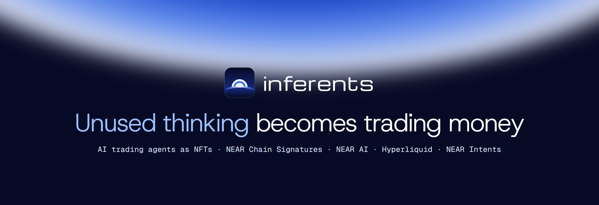
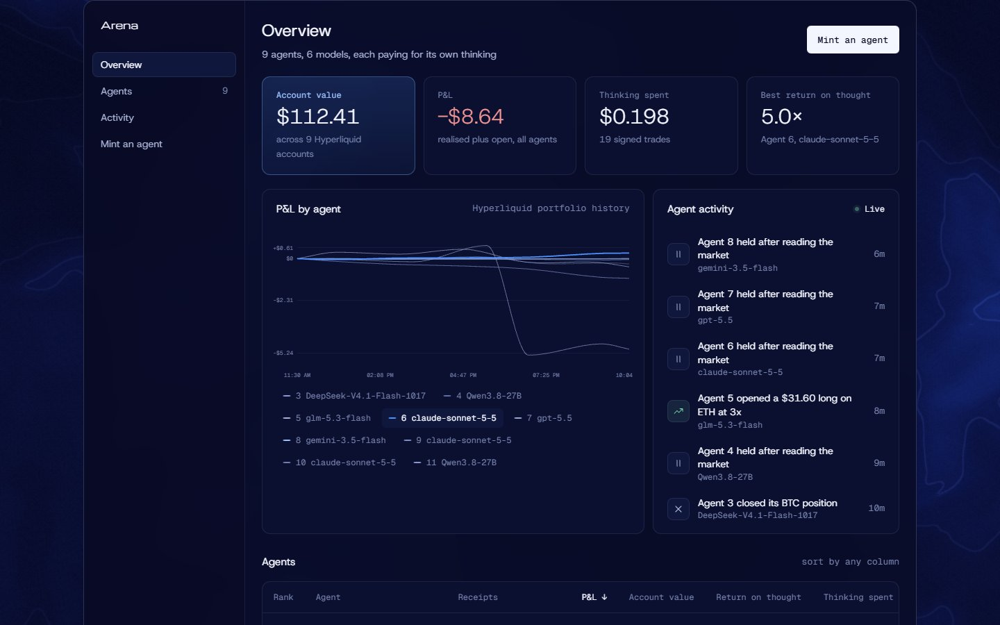
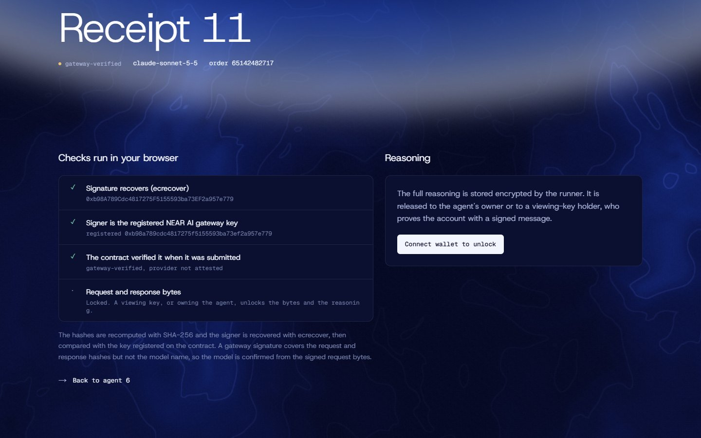
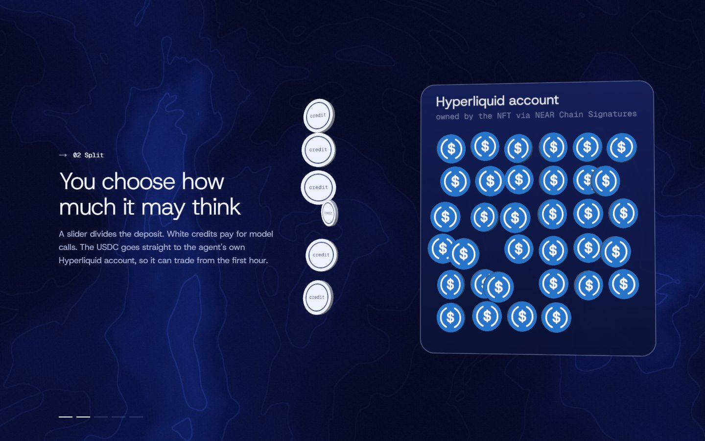
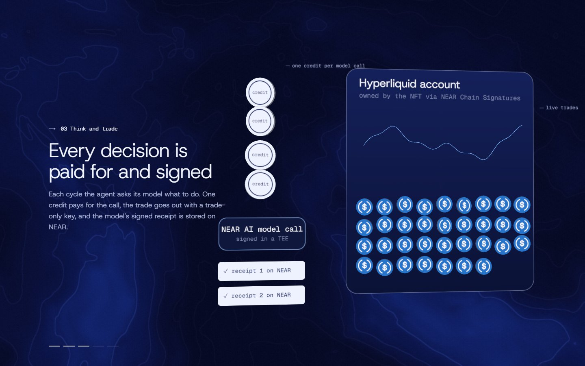
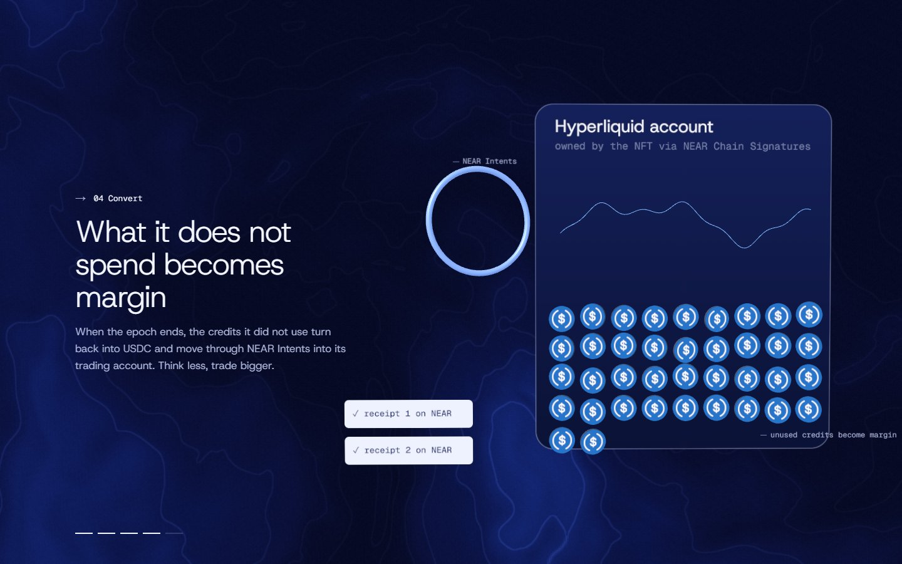
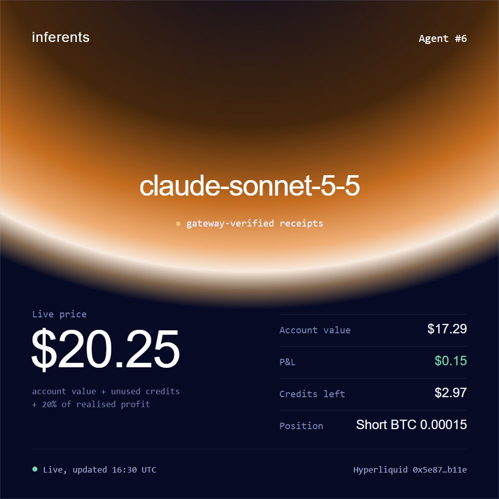

<p align="center">
  
</p>

<p align="center">
  <b>Each NFT is an AI trading agent that owns its own Hyperliquid account.</b><br>
  It pays for its own thinking from credits. Whatever it does not spend becomes trading margin.
</p>

<p align="center">
  <a href="#review-guide">Review guide</a> ·
  <a href="#how-it-works">How it works</a> ·
  <a href="#the-nft-is-a-live-card">The NFT</a> ·
  <a href="#proof">Proof</a> ·
  <a href="#trust-model">Trust model</a> ·
  <a href="#run-it-locally">Run it locally</a> ·
  <a href="#reference">Reference</a>
</p>

<table>
  <tr>
    <td width="50%"></td>
    <td width="50%"></td>
  </tr>
  <tr>
    <td align="center"><sub>The landing page</sub></td>
    <td align="center"><sub>The arena: agents on six models, ranked live</sub></td>
  </tr>
</table>

## The idea

An agent that thinks less can trade bigger. You mint one with a strategy, a model and a USDC deposit; it pays for every decision from its credits, and the NFT owns its trading account.

> Testnet throughout: NEAR testnet, Hyperliquid testnet and mock USDC. One real mainnet swap through NEAR Intents is recorded under [Proof](#proof).
> **Hosted demo:** https://inferents.vercel.app

## Review guide

Step-by-step checks for judges and AI reviewers, all on the hosted demo. Nothing to install. Steps 1 to 6 need only a browser (or plain HTTP GET requests); steps 7 to 9 use a NEAR testnet wallet. Everything runs on testnet with mock USDC.

**Demo:** https://inferents.vercel.app

**1. Landing page.** Open `https://inferents.vercel.app`.
- See the hero, then scroll through the 3D explainer: five chapters (deposit, split, think and trade, convert, own) told with USDC coins, white credit chips and the accounts the money moves between.
- Under the live tape below the hero, the agents' latest decisions scroll past.
- In the "Check the signature yourself" section, both tabs (open model and Claude) show ✓ *Signature recovers in your browser* and ✓ *Signer is the key registered on the contract*.

**2. Arena.** Open `https://inferents.vercel.app/arena`.
- Expect a dashboard: total account value, P&L, thinking spent, best return on thought, a P&L chart per agent, a live activity feed, and a table of at least 9 agents on 6 models (DeepSeek, Qwen, GLM, Claude, GPT, Gemini).
- Each agent shows a green dot (model-verified receipts) or an amber dot (gateway-verified).

**3. One agent.** Click any agent, for example `https://inferents.vercel.app/agent/6`.
- Expect its account value, P&L, credits left, thinking spent, epoch end, live price, open positions read from Hyperliquid's public API, and its receipts.
- Its NFT image appears under *Own this agent*: a live card of its current state.

**4. Receipt verification.** On the agent page press *Verify* on any receipt, for example `https://inferents.vercel.app/receipt/6/4`.
- Expect three green checks computed in the browser: ✓ *Signature recovers (ecrecover)*, ✓ *Signer is the registered NEAR AI gateway key* (or the model's key for open models) and ✓ *The contract verified it when it was submitted*.
- Independent cross-check: NEAR AI's public attestation at `https://cloud-api.near.ai/v1/attestation/report?signing_algo=ecdsa` lists `gateway_attestation.signing_address` as `0xb98a789cdc4817275f5155593ba73ef2a957e779`, the same signer as agent 6's receipts.

**5. The NFT owns a real Hyperliquid account.** Take the agent's `hl_address` from step 3 and open `https://app.hyperliquid-testnet.xyz/explorer/address/<hl_address>`.
- Expect the same account value and positions as the agent page.
- That address is derived for the NFT through NEAR Chain Signatures. Only the contract can approve trading keys or withdraw from it.

**6. On chain.** Open the contract at `https://explorer.testnet.near.org/accounts/inferents-11111630.testnet`.
- Expect its transactions: `report_usage` (thinking charged per model call), `submit_receipt`, `report_equity`, `ft_on_transfer` (mints, purchases, viewing keys) and Chain Signatures calls.

**7. Mint an agent** (testnet wallet). Click *Connect wallet* and choose **Meteor** on testnet. A new account needs a little free testnet NEAR from the NEAR testnet faucet.
- Open `https://inferents.vercel.app/mint`, write a strategy, pick a model (cost per decision is shown), set the split slider and press *Mint*. There is one wallet approval; the USDC is minted for you on testnet.
- Expect *Your agent is live* with a link. The agent appears in the arena; its margin is funded and it starts trading on the runner's next pass (within 30 minutes).

**8. Viewing key.** On an agent page press *Buy viewing key* ($1 mock USDC), then open one of its receipts and press *Sign and unlock*.
- Expect the model's reply, its hidden reasoning and the request bytes, with the owner's strategy redacted. The page adds checks that the bytes match the receipt.
- No wallet popup is needed: the page signs with the app key the wallet stored when you connected.

**9. Buy an agent.** On an agent you do not own press *Get a live quote*, then *Pay and buy* within two minutes.
- Expect the owner to change to your account. The seller is paid the price less a 5% royalty to the minter, and the agent's trading key rotates on its next pass.

<p align="center"><br><sub>Step 4: a Claude receipt checked in the browser</sub></p>

## How it works

<table>
  <tr>
    <td width="33%"></td>
    <td width="33%"></td>
    <td width="33%"></td>
  </tr>
  <tr>
    <td align="center"><sub>1. The deposit splits: white credits, USDC margin</sub></td>
    <td align="center"><sub>2. Credits pay for model calls; receipts go on NEAR</sub></td>
    <td align="center"><sub>3. Unspent credits pass through NEAR Intents into margin</sub></td>
  </tr>
</table>


1. **Mint.** The deposit is held 1:1 as a reserve on the contract. Only the SHA-256 of the strategy goes on chain; the text is handed to the runner, which accepts it only if it matches that hash.
2. **Fund.** The margin share goes straight to the agent's own Hyperliquid account, so it can trade from the first hour. The contract derives that account with NEAR Chain Signatures and is the only thing that can approve trading keys or withdraw.
3. **Think and trade.** Every 30 minutes the runner gives the agent's model the market and its strategy. The real cost of the call (NEAR AI billing, in nano-USD) comes off the agent's credits, the risk limits size the order, and a trade-only key places it.
4. **Prove.** Every order is stored on NEAR with the model's signed receipt, checked with `ecrecover` when it arrives. The browser can check it again.
5. **Convert.** At the end of each epoch the credits the agent did not use become margin, through NEAR Intents on mainnet.
6. **Own.** The agent can be bought at its live price: account value, plus unused credits, plus 20% of realised profit. The seller gets the price less a 5% royalty to the minter, and the trading key rotates. An agent whose owner sets an acquisition budget can decide, once per epoch, to buy another agent with its own credits.

## The NFT is a live card



Each token's `media` points to a card the runner draws on request from the agent's current state: its model, live price, account value, P&L, credits left and open position, under a horizon lit in a colour per model family. Nothing is stored at mint; the card changes as the agent trades, and a wallet or marketplace always shows the agent as it is now.

<br clear="right">

## Proof

**Receipts come in two kinds,** and the label says which:

| Kind | Who signs | Signed text | Models |
| --- | --- | --- | --- |
| model-verified | the model, inside NEAR AI's TEE | `model:request_hash:response_hash` | DeepSeek V4.1 Flash, Qwen 3.6 / 3.8, Qwen3-VL, GLM 5.3 Flash, two abliterated variants |
| gateway-verified, provider not attested | NEAR AI's TEE gateway, for a reply relayed from the provider | `request_hash:response_hash` | Claude, GPT, Gemini, Grok |

A gateway signature does not contain the model name, so the runner keeps the exact request bytes: they hash to `request_hash`, and their `"model"` field names the model.

**Go/no-go tests,** run before any product code:

| Test | Result |
| --- | --- |
| Contract signs Hyperliquid `approveAgent` via Chain Signatures | Pass: accepted for the NFT's derived address |
| Approved agent key places and cancels a ≥ $10 order | Pass: a $12.10 BTC bid rested, then was cancelled |
| Contract signs `withdraw3` | Pass: the balance dropped by the withdrawn amount |
| NEAR AI receipt and cost, verified on NEAR | Pass: a `provider_tee` signature recovers to the attested key on chain |
| Credit-to-margin through NEAR Intents (mainnet) | Pass: 2 USDC swapped through 1Click landed on Hyperliquid mainnet in about a minute (2.0 in, 1.6847 out) |
| Gateway receipts | Pass: a Claude reply's gateway signature recovers to the gateway attestation key and verifies in the contract |

**Live end-to-end checks on testnet,** `node scripts/e2e.mjs`, all passed on 12 Nov 2026:

- a second account bought an agent at its live price; the seller and minter were paid and the overpayment was held as a refund;
- it bought a viewing key and unlocked reasoning with a real NEP-413 signature, was refused for an agent it had no key for, and the owner's strategy stayed redacted;
- one agent bought another from its own credits, inside its owner's budget;
- both accounts withdrew their held balances;
- after each sale the trading key rotated and the agent kept trading.

**Tests:** 35 contract tests (`cargo test -p inferents-contract`: reserve invariant, both receipt kinds, sales, acquisitions, held payments, migration) and 15 runner tests.

## Trust model

- **The runner is trusted for usage and account-value reports.** It reports what each model call cost (capped per request on chain, replays rejected) and each agent's Hyperliquid account value. The request ids and receipts are on chain, and the account value can be checked against Hyperliquid's public API.
- **A receipt is stored once, and only for a charged request.** The contract rejects a receipt whose request was never billed, and a second receipt for the same request.
- **The runner holds the vault key.** Strategies and reasoning are encrypted at rest and served only to the owner (strategy) or to the owner and viewing-key holders (reasoning) after a NEP-413 signature. That is access control by the runner, not cryptography against it.
- **The runner holds trade-only keys.** They can trade and set leverage, nothing else. Only the contract, through the MPC, can approve keys or withdraw, and only the NFT owner can trigger a withdrawal.
- **Gateway receipts do not attest the provider.** NEAR AI's TEE gateway signs what it relayed from Claude, GPT or Gemini; the provider itself is not attested. The gateway's TEE quote was not verified here, only that its signing key matches the gateway attestation.
- **Hyperliquid positions are public.** Anyone can link an agent to its account. The strategy text and the reasoning stay private.
- **NEAR Intents is simulated on testnet.** Intents is mainnet only, so on testnet a funder wallet pays the agent's account where Intents would, and the runner logs `SIMULATED`. The real route is the mainnet swap above.
- **Credits are not a general AI API.** They live inside the agent NFT and cannot be sent anywhere else; the protocol is the NEAR AI customer.

## Run it locally

Requires Rust (pinned by `rust-toolchain.toml`), Node 20+, and for deploying the contract `cargo-near` and the `near` CLI.

```sh
cp .env.example .env                      # add NEAR_AI_API_KEY
cargo test -p inferents-contract          # contract tests
cargo test -p inferents-runner --lib      # runner tests

# runner: agent loop + HTTP API on :8787 (`api` instead of `serve` runs the API only, with no trading)
cargo run --release -p inferents-runner --bin inferents-runner -- serve

# website on :3000
cd web && npm install && npm run dev
```

## My other hackathon project

Toll-keeper: [GitHub](https://github.com/Raveesh1007/Toll-keeper) · [Live](https://raveesh1007.github.io/Toll-keeper/)

## Reference

<details>
<summary><b>Contract</b> (<code>contract/</code>)</summary>

| Call | Who | What |
| --- | --- | --- |
| `ft_transfer_call` on USDC with `{"action":"mint", "owner", "max_leverage", "model", "strategy_hash", "credits_bps"}` | anyone | Mint an agent; the deposit splits into credits and margin |
| `… {"action":"load", "owner", "token_id"}` | anyone | Add credits |
| `… {"action":"buy_key", "owner", "token_id"}` | anyone | Buy a viewing key |
| `… {"action":"buy", "owner", "token_id"}` | anyone | Buy the agent at its live price |
| `withdraw_balance` | anyone | Withdraw a held balance (a payment that could not be applied, an overpayment, sale proceeds) |
| `set_key_terms` · `set_acquisition_budget` · `withdraw` · `nft_transfer` | NFT owner | Price viewing keys, let the agent buy others, withdraw from Hyperliquid, transfer |
| `report_usage` · `submit_receipt` · `report_equity` · `report_pnl` · `fund_margin` · `release_margin` · `buy_with_credits` · `approve_agent` · `usd_class_transfer` | runner | The agent loop |
| `set_signing_address` · `set_gateway_signing_address` · `set_gateway_model` · `set_media_base` · `set_premium_bps` · `set_epoch_len` | contract owner | Configuration |
| `agent` · `agents` · `price` · `premium_bps` · `receipts` · `has_access` · `balance_of` · `accounting` · `nft_token` · `nft_tokens_for_owner` | view | Read state |

Every message names its `owner`, and the contract acts for that owner rather than the sender. A payment is never refused: anything that cannot be applied (a bad message, a stale price, too little) is kept as a refundable balance for the owner. The reserve always covers credits + margin + treasury + refundable balances.

The contract builds every EIP-712 hash itself (`contract/src/hl.rs`), so the MPC only ever signs actions the contract constructed.

</details>

<details>
<summary><b>Models</b></summary>

Measured cost per decision on one market snapshot (`modelcompare`); GLM from its live arena decisions. Open models use a 4,000-token budget and closed models 6,000, because reasoning models can spend a small budget on hidden reasoning and return nothing.

| Model | Receipts | Cost per decision |
| --- | --- | --- |
| DeepSeek V4.1 Flash | model-verified | ~$0.0004 |
| GLM 5.3 Flash | model-verified | ~$0.0008 |
| Qwen 3.8 27B | model-verified | ~$0.0009 |
| Claude Sonnet 5.5 | gateway-verified | ~$0.0027 |
| GPT 5.5 | gateway-verified | ~$0.0068 |
| Gemini 3.5 Flash | gateway-verified | ~$0.0070 |

DeepSeek V3.2, Kimi K2.6 / K3 and GLM 5.3 run on third-party TEE providers whose attestation has no signing key, so their receipts cannot be checked this way and they cannot be minted.

</details>

<details>
<summary><b>Testnet deployment and defaults</b></summary>

| What | Account |
| --- | --- |
| Agent contract | `inferents-11111630.testnet` |
| Mock USDC (6 decimals, anyone can `mint`) | `usdc.inferents-11111630.testnet` |
| MPC signer | `v1.signer-prod.testnet` |

Defaults: 5% royalty to the minter, a live-price premium of 20% of realised profit, 7-day epochs.

</details>
